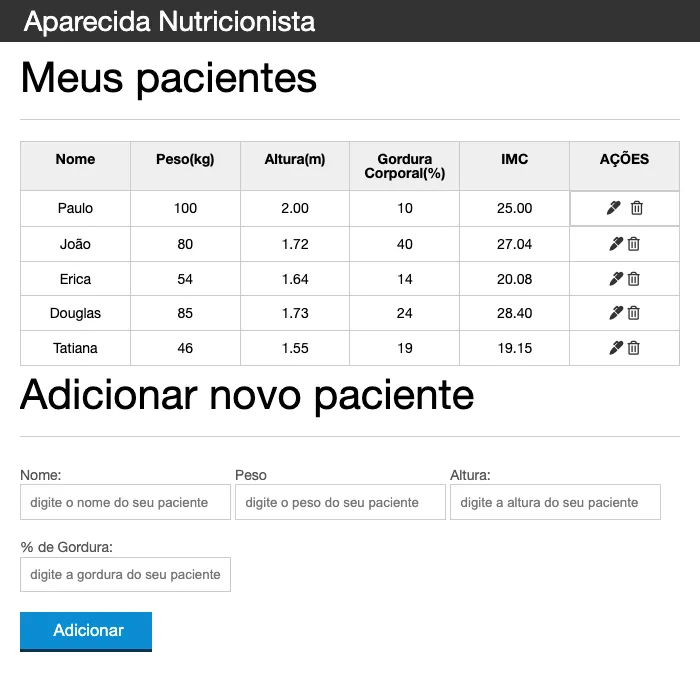
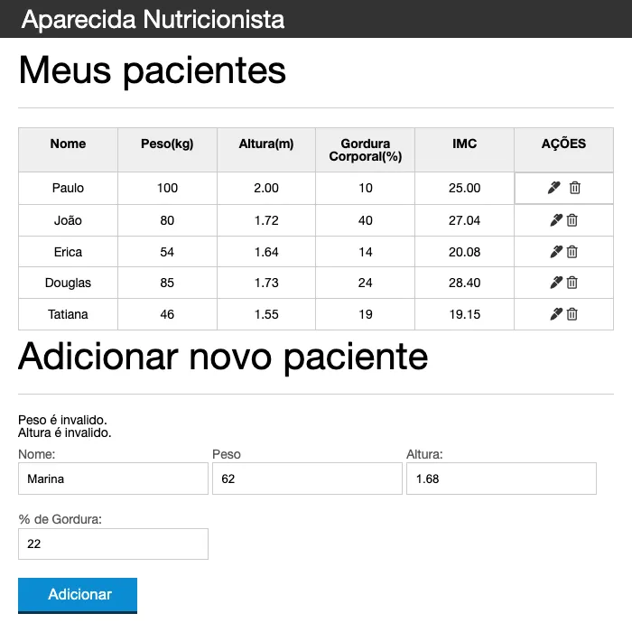

# Calculadora de IMC — Aparecida Nutrição

Página estática em JavaScript puro (sem framework) que lista pacientes de uma nutricionista, calcula o IMC de cada um e permite adicionar, editar e remover linhas da tabela.



## Funcionalidades

- Cálculo automático do IMC (`peso / altura²`, duas casas decimais) para os pacientes já presentes na tabela.
- Validação de peso (0–600 kg) e altura (0–3 m): valores fora da faixa aparecem como "Peso inválido!" / "Altura inválida!" na coluna IMC.
- Formulário "Adicionar novo paciente" com mensagens de erro por campo.
- Remoção de linha com animação de fade-out (ícone de lixeira).
- Edição inline: o ícone de lápis transforma a linha em campos de texto, com botões de salvar e cancelar.

## Como funciona

| Arquivo | Papel |
|---|---|
| `index.html` | Tabela com 5 pacientes de exemplo e o formulário. Font Awesome 5.6.3 vem de CDN. |
| `js/principal.js` | Troca o título da página para "Aparecida Nutricionista". |
| `js/calcula-imc.js` | Percorre as linhas `.paciente`, valida e preenche a coluna IMC; expõe `calculaImc`, `validaPeso` e `validaAltura`. |
| `js/forms.js` | Lê o formulário, valida (`validaPaciente`), monta a linha (`montaTr`/`montaTd`) e exibe erros em `#msg-erro`. |
| `js/remove-paciente.js` | Delegação de eventos em `#tabela-pacientes`: remover, editar, salvar e cancelar edição. |
| `js/edita-paciente.js` | Versão antiga da remoção, toda comentada e não carregada pelo `index.html`. |

## Stack

HTML, CSS (reset + estilos próprios) e JavaScript (ES6, DOM API).

## Como rodar

Não há build nem dependências. Abra o `index.html` no navegador ou sirva a pasta:

```bash
python3 -m http.server 8000
# http://localhost:8000
```

Os ícones de editar/remover dependem de internet (CDN do Font Awesome).

## Estrutura

```
.
├── index.html
├── favicon.ico
├── css/        # reset.css, index.css
└── js/         # principal, calcula-imc, forms, remove-paciente, edita-paciente
```

## Limitações conhecidas

- **"Adicionar" nunca adiciona o paciente.** Em `js/forms.js`, `validaPaciente` testa `if (validaPeso(...))` e `if (validaAltura(...))` sem o `!`, então valores válidos geram "Peso é invalido." / "Altura é invalido." e valores inválidos passam. Além disso, `montaTr` não tem `return pacienteTr`, então mesmo sem erros o `appendChild` recebe `undefined` e lança exceção.

  

- A edição inline não recalcula o IMC nem valida os novos valores.
- A edição insere o texto da célula direto em `value="..."` via `innerHTML`; aspas no conteúdo quebram o campo.
